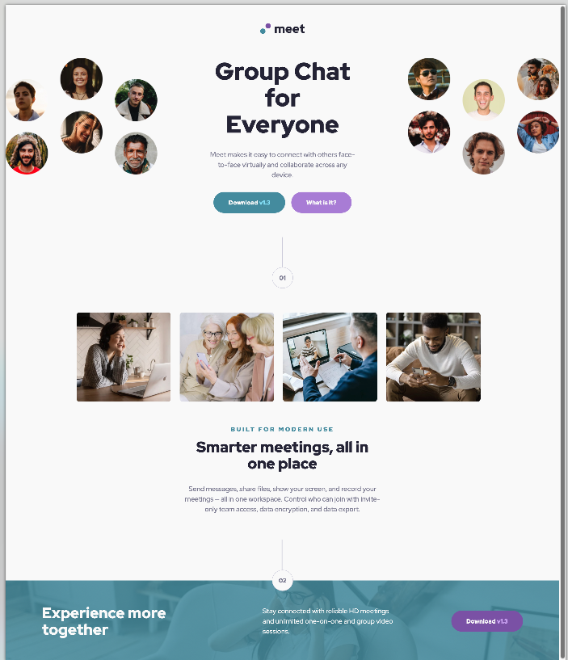

# Frontend Mentor - Meet landing page solution

This is a solution to the [Meet landing page challenge on Frontend Mentor](https://www.frontendmentor.io/challenges/meet-landing-page-rbTDS6OUR). Frontend Mentor challenges help you improve your coding skills by building realistic projects. 

## Table of contents

- [Overview](#overview)
  - [The challenge](#the-challenge)
  - [Screenshot](#screenshot)
  - [Links](#links)
- [My process](#my-process)
  - [Built with](#built-with)
  - [What I learned](#what-i-learned)
  - [Useful resources](#useful-resources)
  - [AI Collaboration](#ai-collaboration)
- [Author](#author)

## Overview

### The challenge

Users should be able to:

- View the optimal layout depending on their device's screen size
- See hover states for interactive elements

### Screenshot

### Links

- Solution URL: [GitHub](https://github.com/RoomForEpsilon/meet-landing-page/pull/1)
- Live Site URL: [Live site](https://roomforepsilon.github.io/meet-landing-page/)

## My process

### Built with

- Semantic HTML5 markup
- CSS custom properties
- Flexbox
- CSS Grid
- Mobile-first workflow

### What I learned

The major things that I can remember from working on this project are:

  * I need to use reusable styles more.
  * I learned more about absolute and relative positioning.
  * I learned how to overlay a background image with color.

Currently, I start styling at the top of the page and work my way down. What I'd like to do is look at the design to see where there are repeatable design options and take those into account when I create the stylesheet. For example, this project has text components in the hero and main content sections. They could share some styles, and wrapping each component in a div and styling those divs would reduce the amount of code in the stylesheet and potentially make it easier to understand.

I also used absolute and relative positioning in this project to style the number designs and the desktop hero banner. I was having trouble using absolute positioning until I realized that I could give the parent of the element I wanted to position absolutely `position: relative`. Doing that makes it a lot easier to control where the absolutely positioned element ends up.

Overlaying a background image with color took a while for me to figure out. The first major hurdle was that I tried to mix the background image with the cyan color using `background-blend-mode`. It looked cool, but the resulting image didn't look like the design. So then I decided to use two linear gradients and fiddled with their opacity, and that worked.

### Useful resources

- [CSS-Tricks' article on background-blend-mode](https://css-tricks.com/almanac/properties/b/background-blend-mode/) - This helped me understand how to use `background-blend-mode`.

### AI Collaboration

I usually asked it if a decision I made was a good choice. I also asked it questions when I got stuck.

## Author

- Frontend Mentor - [@RoomForEpsilon](https://www.frontendmentor.io/profile/RoomForEpsilon)
